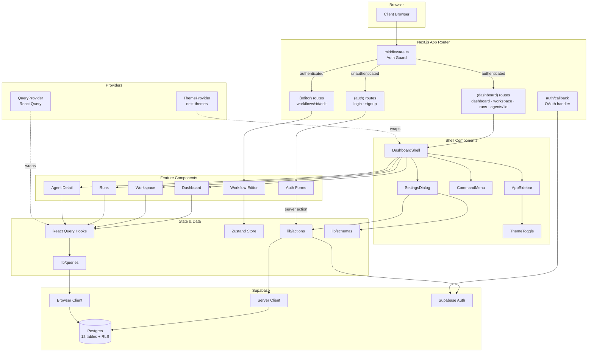
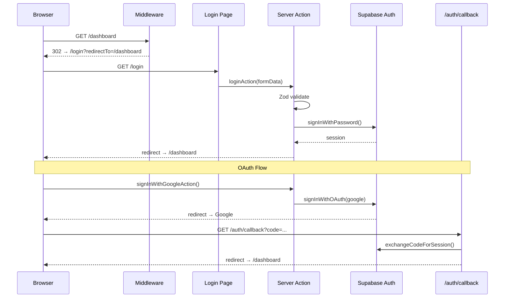
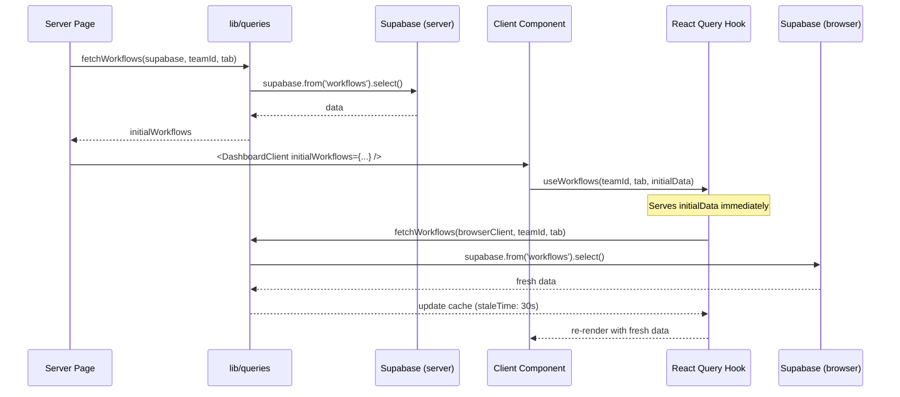
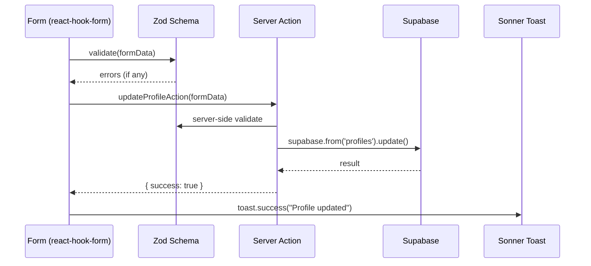

# Codebase Map

> Auto-generated by Cartographer. Last mapped: 2026-02-08T15:57:44Z

## System Overview



## Directory Structure

```
relay/
├── src/
│   ├── app/                              # Next.js App Router (15 files)
│   │   ├── layout.tsx                    # Root layout (Inter font, ThemeProvider, QueryProvider, Toaster)
│   │   ├── page.tsx                      # Home page (/)
│   │   ├── globals.css                   # Tailwind v4 theme, OKLCH CSS variables, dark mode
│   │   ├── favicon.ico
│   │   ├── (auth)/                       # Auth route group (no sidebar)
│   │   │   ├── layout.tsx                # Centered auth layout
│   │   │   ├── login/page.tsx            # Login page
│   │   │   └── signup/page.tsx           # Signup page
│   │   ├── (dashboard)/                  # Dashboard route group (sidebar + shell)
│   │   │   ├── layout.tsx                # DashboardShell wrapper
│   │   │   ├── dashboard/page.tsx        # Dashboard page
│   │   │   ├── workspace/page.tsx        # Workspace page
│   │   │   ├── runs/page.tsx             # Runs page
│   │   │   └── agents/[id]/page.tsx      # Agent detail page
│   │   ├── (editor)/                     # Editor route group (full-width, no sidebar)
│   │   │   ├── layout.tsx                # Editor layout
│   │   │   └── workflows/[id]/edit/page.tsx  # Workflow editor page
│   │   └── auth/callback/route.ts        # OAuth callback handler
│   │
│   ├── middleware.ts                      # Auth guard: protects /dashboard, /workspace, /runs, /agents, /workflows
│   │
│   ├── components/                        # All components (~108 source + 22 tests)
│   │   ├── app-sidebar.tsx               # Fixed left sidebar with nav, usage, theme toggle
│   │   ├── command-menu.tsx              # Global Cmd+K search palette
│   │   ├── dashboard-shell.tsx           # Root layout: sidebar + command menu + settings + content
│   │   ├── search-trigger.tsx            # Header search button → opens command menu
│   │   ├── theme-toggle.tsx              # Light/dark/system dropdown (next-themes)
│   │   ├── __tests__/                    # Tests for top-level components (3 files)
│   │   ├── ui/                           # shadcn/ui primitives (24 files)
│   │   ├── auth/                         # Login, signup, OAuth (4 + 3 tests)
│   │   ├── dashboard/                    # Dashboard page components (9 + 2 tests)
│   │   ├── workspace/                    # Workspace page components (8 files)
│   │   ├── runs/                         # Runs page components (7 + 1 test)
│   │   ├── agent-detail/                 # Agent detail components (7 + 6 tests)
│   │   ├── workflow-editor/              # 3-panel editor components (12 + 2 tests)
│   │   ├── settings/                     # Settings dialog + 6 sections (10 + 2 tests)
│   │   └── shared/                       # EmptyState, SkeletonRows, StatusBadge (3 + 2 tests)
│   │
│   ├── hooks/                             # React Query hooks + utilities (7 + 1 test)
│   │   ├── use-agents.ts                 # Agents with skills (React Query)
│   │   ├── use-debounce.ts               # Generic debounce (300ms default)
│   │   ├── use-mobile.ts                 # Breakpoint detection (768px)
│   │   ├── use-runs.ts                   # Infinite query for runs (cursor pagination)
│   │   ├── use-workflow-run-stats.ts     # Run counts + sparkline data
│   │   ├── use-workflows.ts              # Workflow list by tab
│   │   ├── use-workspace-items.ts        # Workspace tree (agents + workflows)
│   │   └── __tests__/use-debounce.test.ts
│   │
│   ├── stores/                            # Zustand stores (1 + 1 test)
│   │   ├── workflow-editor-store.ts      # Editor state: trigger, steps, selection, dirty flag
│   │   └── __tests__/workflow-editor-store.test.ts
│   │
│   ├── providers/                         # Context providers (2 files)
│   │   ├── query-provider.tsx            # React Query with devtools
│   │   └── theme-provider.tsx            # next-themes wrapper
│   │
│   ├── types/                             # Shared types (1 file)
│   │   └── navigation.ts                # NavItem, UserData, TeamData, UsageData
│   │
│   ├── lib/                               # Business logic & utilities
│   │   ├── utils.ts                      # cn() — clsx + tailwind-merge
│   │   ├── supabase/                     # Supabase clients + types (3 files)
│   │   │   ├── client.ts                # createBrowserClient()
│   │   │   ├── server.ts                # createServerClient() (async, cookie-based)
│   │   │   └── database.types.ts        # Generated DB types (12 tables, 6 enums)
│   │   ├── queries/                      # Data fetching functions (3 files)
│   │   │   ├── dashboard.ts             # fetchTeam, fetchAgentsWithSkills, fetchWorkflows, fetchWorkflowRunStats
│   │   │   ├── runs.ts                  # fetchRuns (cursor pagination), fetchWorkflowList
│   │   │   └── workspace.ts             # fetchWorkspaceItems, fetchTeamMembers
│   │   ├── actions/                      # Server actions (2 files)
│   │   │   ├── auth.ts                  # loginAction, signupAction, signOutAction, signInWithGoogleAction
│   │   │   └── settings.ts             # updateProfileAction, updateWorkspaceAction
│   │   ├── schemas/                      # Zod validation (2 + 2 tests)
│   │   │   ├── auth.ts                  # loginSchema, signupSchema
│   │   │   └── settings.ts             # accountSettingsSchema, workspaceSettingsSchema
│   │   ├── workflow-editor/              # Step/trigger logic (4 + 3 tests)
│   │   │   ├── step-defaults.ts         # getStepDefaultConfig, isStepConfigComplete (8 step types)
│   │   │   ├── step-metadata.ts         # STEP_TYPES, getStepMeta, CONNECTED_APPS
│   │   │   ├── trigger-defaults.ts      # getTriggerDefaultConfig, isTriggerConfigComplete (9 trigger types)
│   │   │   └── trigger-metadata.ts      # TRIGGER_TYPES, getTriggerMeta
│   │   ├── utils/                        # Formatting helpers (2 + 2 tests)
│   │   │   ├── format-duration.ts       # formatDuration(startedAt, completedAt)
│   │   │   └── format-relative-time.ts  # formatRelativeTime(dateStr)
│   │   ├── data/                         # Static data (1 file)
│   │   │   └── app-integrations.ts      # APP_INTEGRATIONS (100+ apps, 31 categories)
│   │   └── __tests__/utils.test.ts
│   │
│   └── test/
│       └── setup.ts                      # Vitest setup (@testing-library/jest-dom)
│
├── e2e/                                   # Playwright E2E tests (11 files)
│   ├── smoke.test.ts                     # Homepage loads
│   ├── auth.test.ts                      # Login/signup form rendering, redirects
│   ├── navigation.test.ts               # Auth guard redirects
│   ├── dashboard.test.ts                # Dashboard auth gate
│   ├── workspace.test.ts                # Workspace auth gate
│   ├── runs.test.ts                     # Runs auth gate
│   ├── command-menu.test.ts             # Cmd+K blocked on public pages
│   ├── workflow-editor.test.ts          # Editor auth gate
│   ├── workflow-editor-panels.test.ts   # Editor panels auth gate
│   ├── settings.test.ts                 # Settings auth gate
│   └── agent-detail.test.ts             # Agent detail auth gate + invalid ID handling
│
├── supabase/
│   └── schema.sql                        # Full DB schema (12 tables, 6 enums, RLS policies)
│
├── docs/
│   ├── CODEBASE_MAP.md                   # This file
│   └── DEVELOPMENT_SPEC.md              # High-level development spec
│
└── [config]
    ├── package.json                      # Deps & scripts (bun dev/build/start/lint)
    ├── tsconfig.json                     # Strict TS, bundler resolution, @/* → src/*
    ├── next.config.ts                    # Next.js config
    ├── vitest.config.ts                  # Vitest + happy-dom
    ├── playwright.config.ts              # Playwright (chromium)
    ├── eslint.config.mjs                 # ESLint v9 flat config + Next.js
    ├── postcss.config.mjs                # PostCSS + @tailwindcss/postcss
    ├── components.json                   # shadcn/ui config (new-york style)
    ├── .prettierrc                       # Prettier config
    ├── .prettierignore                   # Prettier ignore
    └── .env.example                      # Environment variable template
```

## Module Guide

### App Routes (`src/app/`) — 15 files

Three route groups isolate layout concerns:

| Route Group   | Layout                            | Pages                                               |
| ------------- | --------------------------------- | --------------------------------------------------- |
| `(auth)`      | Centered card, no sidebar         | `/login`, `/signup`                                 |
| `(dashboard)` | DashboardShell (sidebar + header) | `/dashboard`, `/workspace`, `/runs`, `/agents/[id]` |
| `(editor)`    | Full-width, no sidebar            | `/workflows/[id]/edit`                              |

Root `layout.tsx` wraps everything with `ThemeProvider` → `QueryProvider` → `Toaster`.

Middleware (`src/middleware.ts`) guards `/dashboard`, `/workspace`, `/runs`, `/agents`, `/workflows` — redirects unauthenticated users to `/login?redirectTo=...` and authenticated users away from auth pages.

`auth/callback/route.ts` handles the OAuth redirect from Supabase Auth.

---

### Top-Level Components (`src/components/`) — 5 files

| Component        | Purpose                                                                       |
| ---------------- | ----------------------------------------------------------------------------- |
| `DashboardShell` | Root layout: composes sidebar + command menu + settings dialog + page content |
| `AppSidebar`     | Fixed left nav with sections, usage meters, theme toggle, user menu, sign out |
| `CommandMenu`    | Global `Cmd+K` palette — searches workflows, agents, runs                     |
| `SearchTrigger`  | Header button that opens CommandMenu                                          |
| `ThemeToggle`    | Dropdown for light / dark / system theme (via `next-themes`)                  |

All are client components. `DashboardShell` is the composition root for dashboard pages.

---

### UI Components (`src/components/ui/`) — 24 files

shadcn/ui primitives (new-york style), all built on Radix UI + CVA:

`avatar` · `badge` · `button` · `card` · `checkbox` · `command` · `dialog` · `dropdown-menu` · `input` · `label` · `popover` · `progress` · `scroll-area` · `select` · `separator` · `sheet` · `sidebar` · `skeleton` · `slider` · `switch` · `table` · `tabs` · `textarea` · `tooltip`

Key patterns:

- CVA for variant management (button: 6 variants, 7+ sizes)
- Compound components (Card → CardHeader, CardTitle, CardContent, etc.)
- `data-slot` attributes on all components
- `cn()` for className composition

---

### Dashboard (`src/components/dashboard/`) — 9 files

| Component             | Purpose                                                                        |
| --------------------- | ------------------------------------------------------------------------------ |
| `DashboardClient`     | Main orchestrator — receives server data, renders sections                     |
| `TeamSection`         | Team name and avatar                                                           |
| `AgentsGrid`          | Grid of `AgentCard` components                                                 |
| `AgentCard`           | Agent name, avatar, description, first 3 skills                                |
| `AnimatedAgentAvatar` | Animated bot avatar with gradient                                              |
| `WorkflowsSection`    | Tabbed workflow list (needs-attention, recently-edited, recently-run, starred) |
| `WorkflowListItem`    | Workflow row with sparkline, run count, last run                               |
| `ActivitySparkline`   | Mini 7-day bar chart                                                           |
| `SkillChip`           | Skill badge (emoji + name)                                                     |

Data flow: Server page → `fetchTeam` + `fetchAgentsWithSkills` + `fetchWorkflows` → `DashboardClient` (initialData) → React Query hooks for live updates.

---

### Agent Detail (`src/components/agent-detail/`) — 7 files

| Component            | Purpose                                   |
| -------------------- | ----------------------------------------- |
| `AgentInfo`          | Name and description                      |
| `AgentAvatar`        | Large avatar with fallback                |
| `ActivityHeatmap`    | 6-month GitHub-style contribution heatmap |
| `SkillsList`         | Agent skills with badges                  |
| `RunHistory`         | Recent runs table                         |
| `ChatInput`          | Chat textarea with send button            |
| `ProgressIndicators` | Workflow/run count badges                 |

Uses `date-fns` for heatmap date calculations.

---

### Runs (`src/components/runs/`) — 7 files

| Component        | Purpose                                                     |
| ---------------- | ----------------------------------------------------------- |
| `RunsClient`     | Orchestrator with filters, debounced search, infinite query |
| `RunsHeader`     | Page title and actions                                      |
| `RunsFilters`    | Search + status/workflow dropdowns                          |
| `RunsTable`      | Table with infinite scroll                                  |
| `RunRow`         | Run detail row                                              |
| `RunStatusBadge` | Color-coded status (animated pulse for "running")           |
| `RunsEmptyState` | Empty state with CTA                                        |

Uses `useRuns` hook with cursor-based pagination and 10s auto-refetch when runs are active.

---

### Settings (`src/components/settings/`) — 10 files

| Component              | Purpose                             |
| ---------------------- | ----------------------------------- |
| `SettingsDialog`       | Main dialog with sidebar navigation |
| `SettingsSidebar`      | Section list navigation             |
| `AccountSection`       | Profile form (name, email, avatar)  |
| `NotificationsSection` | Notification preferences            |
| `ManageAppsSection`    | OAuth app integrations grid         |
| `GeneralSection`       | Team name and slug                  |
| `MembersSection`       | Team members table with roles       |
| `BillingSection`       | Usage meters and plan info          |
| `AppIntegrationRow`    | Individual app card                 |
| `index.ts`             | Barrel export                       |

Forms use `react-hook-form` + `zod` + server actions. `sonner` for toast notifications.

---

### Auth (`src/components/auth/`) — 4 files

| Component          | Purpose                         |
| ------------------ | ------------------------------- |
| `LoginForm`        | Email/password login with OAuth |
| `SignupForm`       | Registration with OAuth         |
| `OAuthButton`      | Google OAuth button             |
| `AuthErrorMessage` | Error display                   |

Form flow: `react-hook-form` → `zod` schema → server action → Supabase Auth → redirect.

---

### Workflow Editor (`src/components/workflow-editor/`) — 12 files

| Component          | Purpose                                        |
| ------------------ | ---------------------------------------------- |
| `EditorLayout`     | 3-panel layout (assistant \| canvas \| config) |
| `AIAssistantPanel` | Left panel: AI chat + use cases                |
| `StepCanvas`       | Center: trigger + steps + connectors           |
| `StepConfigPanel`  | Right: selected step configuration form        |
| `TopBar`           | Editor header (name, save, test, publish)      |
| `TriggerBlock`     | Trigger card with icon                         |
| `TriggerSelector`  | Popover for choosing trigger type (9 types)    |
| `StepCard`         | Step card with reorder controls                |
| `StepSelector`     | Dialog for choosing step type (8 types)        |
| `AddStepButton`    | + button between steps                         |
| `ConnectorLine`    | Visual line between steps                      |
| `UseCaseCard`      | AI assistant use case suggestion               |

State managed by Zustand (`useWorkflowEditorStore`). Desktop: 3-panel. Mobile: Sheet for config.

---

### Workspace (`src/components/workspace/`) — 8 files

| Component          | Purpose                                            |
| ------------------ | -------------------------------------------------- |
| `WorkspaceClient`  | Orchestrator with filters, search, sort, selection |
| `WorkspaceHeader`  | Page title and actions                             |
| `WorkspaceFilters` | Search + createdBy + status + type filters         |
| `WorkspaceTable`   | Table with checkbox selection, sortable headers    |
| `AgentRow`         | Expandable agent row (shows nested workflows)      |
| `WorkflowRow`      | Workflow row with status, steps, AI usage          |
| `ViewToggle`       | Folder/list/graph view toggle                      |
| `SplitButton`      | Dropdown button with primary + secondary actions   |

Multi-select via Set, expandable agent rows, client-side filtering with 300ms debounce.

---

### Shared (`src/components/shared/`) — 3 files

| Component      | Used By                                       |
| -------------- | --------------------------------------------- |
| `EmptyState`   | Runs, Workspace — centered icon + title + CTA |
| `SkeletonRows` | Runs, Workspace — table loading skeleton      |
| `StatusBadge`  | Workspace — active/draft/archived badge       |

---

### Hooks (`src/hooks/`) — 7 files

| Hook                                     | Purpose                   | Data Source             |
| ---------------------------------------- | ------------------------- | ----------------------- |
| `useAgents(teamId, initialData)`         | Agents + skills           | `fetchAgentsWithSkills` |
| `useWorkflows(teamId, tab, initialData)` | Workflows by tab          | `fetchWorkflows`        |
| `useRuns(teamId, filters, initialData)`  | Paginated runs (infinite) | `fetchRuns`             |
| `useWorkflowRunStats(workflowIds)`       | Run counts + sparklines   | `fetchWorkflowRunStats` |
| `useWorkspaceItems(teamId, initialData)` | Workspace tree            | `fetchWorkspaceItems`   |
| `useDebounce(value, delay)`              | Generic debounce          | —                       |
| `useIsMobile()`                          | Viewport ≤ 768px          | `matchMedia`            |

All React Query hooks accept `initialData` from server for SSR hydration. Default `staleTime`: 30s.

---

### Store (`src/stores/`) — 1 file

**`useWorkflowEditorStore`** (Zustand):

- **State**: `workflowId`, `workflowName`, `workflowEmoji`, `isStarred`, `trigger`, `steps[]`, `selectedStepId`, `isAssistantOpen`, `isDirty`
- **Actions**: `setTrigger`, `addStep`, `updateStep`, `deleteStep`, `reorderSteps`, `selectStep`, `toggleAssistant`, `initializeWorkflow`, `resetStore`
- Tracks `isDirty` for unsaved changes detection

---

### Queries (`src/lib/queries/`) — 3 files

| Function                                       | Returns                                        |
| ---------------------------------------------- | ---------------------------------------------- |
| `fetchTeam(supabase, teamId)`                  | Team metadata                                  |
| `fetchAgentsWithSkills(supabase, teamId)`      | Agents with nested skills                      |
| `fetchWorkflows(supabase, teamId, tab)`        | Workflows filtered by dashboard tab            |
| `fetchWorkflowRunStats(supabase, workflowIds)` | Run counts + 14-day sparkline data             |
| `fetchRuns(supabase, teamId, options)`         | Paginated runs (cursor-based, limit+1 pattern) |
| `fetchWorkflowList(supabase, teamId)`          | Workflow dropdown options                      |
| `fetchWorkspaceItems(supabase, teamId)`        | Hierarchical agents → workflows tree           |
| `fetchTeamMembers(supabase, teamId)`           | Team member list                               |

All accept a Supabase client instance (browser or server). Manual joins via Maps for performance.

---

### Actions (`src/lib/actions/`) — 2 files

| Action                            | Purpose                                      |
| --------------------------------- | -------------------------------------------- |
| `loginAction(formData)`           | Email/password login → redirect to dashboard |
| `signupAction(formData)`          | Registration → redirect to dashboard         |
| `signOutAction()`                 | Sign out → redirect to login                 |
| `signInWithGoogleAction()`        | OAuth → redirect to Google                   |
| `updateProfileAction(formData)`   | Update user full_name                        |
| `updateWorkspaceAction(formData)` | Update team name                             |

All use `'use server'` directive. Pattern: FormData → Zod validation → Supabase → redirect/result.

---

### Schemas (`src/lib/schemas/`) — 2 files

| Schema                    | Fields                            |
| ------------------------- | --------------------------------- |
| `loginSchema`             | email, password (min 8)           |
| `signupSchema`            | fullName, email, password (min 8) |
| `accountSettingsSchema`   | fullName                          |
| `workspaceSettingsSchema` | workspaceName                     |

Zod schemas with `z.infer` type exports.

---

### Supabase Clients (`src/lib/supabase/`) — 3 files

| File                | Export                         | Usage                                  |
| ------------------- | ------------------------------ | -------------------------------------- |
| `client.ts`         | `createBrowserClient()`        | Client components (hooks)              |
| `server.ts`         | `createServerClient()`         | Server components, actions, middleware |
| `database.types.ts` | `Database`, enums, table types | Type-safe queries everywhere           |

Server client is async (Next.js 15+ cookies API). Both validate env vars on creation.

---

### Workflow Editor Logic (`src/lib/workflow-editor/`) — 4 files

**Step types** (8): `app` · `ai` · `http` · `conditional` · `loop` · `delay` · `transform` · `utility`
**Trigger types** (9): `manual` · `scheduled` · `webhook` · `email` · `form` · `app` · `record` · `file` · `event`

| Export                                   | Purpose                                             |
| ---------------------------------------- | --------------------------------------------------- |
| `getStepDefaultConfig(type)`             | Default config per step type                        |
| `isStepConfigComplete(step)`             | Validates required fields (AI → prompt, HTTP → URL) |
| `STEP_TYPES` / `getStepMeta(type)`       | UI metadata (icon, name, description)               |
| `getTriggerDefaultConfig(type)`          | Default config per trigger type                     |
| `isTriggerConfigComplete(trigger)`       | Validates required fields                           |
| `getTriggerSummary(trigger)`             | Human-readable trigger description                  |
| `TRIGGER_TYPES` / `getTriggerMeta(type)` | UI metadata for triggers                            |

Discriminated union types (`StepConfigMap`, `TriggerConfigMap`) for type-safe config.

---

### Utils (`src/lib/utils.ts` + `src/lib/utils/`) — 3 files

| Export                                   | Purpose                                        |
| ---------------------------------------- | ---------------------------------------------- |
| `cn(...inputs)`                          | Merge Tailwind classes (clsx + tailwind-merge) |
| `formatDuration(startedAt, completedAt)` | "2m 34s", "< 1s"                               |
| `formatRelativeTime(dateStr)`            | "2 hours ago" or "Jan 15, 2026"                |

---

### Data (`src/lib/data/`) — 1 file

`APP_INTEGRATIONS` — Array of 100+ app objects with name, description, category (31 categories), auth type, icon slug. Used in settings manage-apps and workflow editor step config.

---

### Providers (`src/providers/`) — 2 files

| Provider        | Wraps                                                                    |
| --------------- | ------------------------------------------------------------------------ |
| `QueryProvider` | `@tanstack/react-query` `QueryClientProvider` + devtools                 |
| `ThemeProvider` | `next-themes` `ThemeProvider` (attribute="class", defaultTheme="system") |

Both mounted in root `layout.tsx`.

---

### Types (`src/types/`) — 1 file

| Type        | Fields                                                                                |
| ----------- | ------------------------------------------------------------------------------------- |
| `NavItem`   | `title`, `url`, `icon` (LucideIcon), `action?` (command-menu \| settings \| external) |
| `UserData`  | `name`, `email`, `avatar`                                                             |
| `TeamData`  | `name`, `slug`                                                                        |
| `UsageData` | `stepsUsed`, `stepsLimit`, `aiCreditsUsed`, `aiCreditsLimit`                          |

---

### Database (`supabase/schema.sql`)

12 tables with RLS enabled on all:

| Table               | Key Relationships                                  |
| ------------------- | -------------------------------------------------- |
| `profiles`          | Extends `auth.users` (auto-created via trigger)    |
| `teams`             | —                                                  |
| `team_members`      | profiles ↔ teams (junction, with `team_role` enum) |
| `agents`            | → teams, profiles                                  |
| `folders`           | → teams, self-referencing (parent_id)              |
| `workflows`         | → teams, folders, profiles                         |
| `workflow_triggers` | → workflows (1:1 via UNIQUE constraint)            |
| `workflow_steps`    | → workflows                                        |
| `agent_skills`      | agents ↔ workflows (junction)                      |
| `workflow_runs`     | → workflows, agents                                |
| `app_connections`   | → profiles, teams                                  |
| `usage`             | → teams                                            |

6 enums: `team_role`, `workflow_status`, `trigger_type`, `step_type`, `run_status`, `connection_status`

All tables have `updated_at` triggers. Foreign keys use `ON DELETE CASCADE` or `SET NULL`. Indexes on foreign keys and common query patterns.

---

### E2E Tests (`e2e/`) — 11 files

All tests currently verify **unauthenticated behavior** (auth gate → redirect to `/login`):

| Test                             | Coverage                                             |
| -------------------------------- | ---------------------------------------------------- |
| `smoke.test.ts`                  | Homepage loads with correct title                    |
| `auth.test.ts`                   | Login/signup form rendering, navigation between them |
| `navigation.test.ts`             | Unauthenticated redirects from protected pages       |
| `dashboard.test.ts`              | Dashboard auth gate                                  |
| `workspace.test.ts`              | Workspace auth gate                                  |
| `runs.test.ts`                   | Runs auth gate                                       |
| `command-menu.test.ts`           | Cmd+K blocked on public pages                        |
| `workflow-editor.test.ts`        | Editor auth gate                                     |
| `workflow-editor-panels.test.ts` | Editor panels auth gate                              |
| `settings.test.ts`               | Settings auth gate                                   |
| `agent-detail.test.ts`           | Agent detail auth gate + invalid ID handling         |

Uses role-based selectors (accessibility-first). No authenticated test fixtures yet.

---

### Unit Tests — 31 files across `src/**/__tests__/`

Test runner: **Vitest** + `@testing-library/react` + `happy-dom`

Coverage areas: component rendering, Zustand store actions, Zod schema validation, utility functions, hook behavior.

## Data Flow Diagrams

### Auth Flow



### Page Data Flow



### Form Mutation Flow



## Component Hierarchy

```
RootLayout (layout.tsx)
├── ThemeProvider
│   └── QueryProvider
│       ├── Toaster (sonner)
│       │
│       ├── (auth) Layout
│       │   ├── LoginForm
│       │   │   ├── OAuthButton
│       │   │   └── AuthErrorMessage
│       │   └── SignupForm
│       │       ├── OAuthButton
│       │       └── AuthErrorMessage
│       │
│       ├── (dashboard) Layout → DashboardShell
│       │   ├── AppSidebar
│       │   │   └── ThemeToggle
│       │   ├── SearchTrigger
│       │   ├── CommandMenu
│       │   ├── SettingsDialog
│       │   │   ├── SettingsSidebar
│       │   │   ├── AccountSection
│       │   │   ├── NotificationsSection
│       │   │   ├── ManageAppsSection
│       │   │   │   └── AppIntegrationRow[]
│       │   │   ├── GeneralSection
│       │   │   ├── MembersSection
│       │   │   └── BillingSection
│       │   │
│       │   └── [Page Content]
│       │       ├── DashboardClient
│       │       │   ├── TeamSection
│       │       │   ├── AgentsGrid
│       │       │   │   └── AgentCard[]
│       │       │   │       ├── AnimatedAgentAvatar
│       │       │   │       └── SkillChip[]
│       │       │   └── WorkflowsSection
│       │       │       └── WorkflowListItem[]
│       │       │           └── ActivitySparkline
│       │       │
│       │       ├── WorkspaceClient
│       │       │   ├── WorkspaceHeader
│       │       │   │   └── SplitButton
│       │       │   ├── WorkspaceFilters
│       │       │   │   └── ViewToggle
│       │       │   └── WorkspaceTable
│       │       │       ├── AgentRow[] (expandable)
│       │       │       └── WorkflowRow[]
│       │       │
│       │       ├── RunsClient
│       │       │   ├── RunsHeader
│       │       │   ├── RunsFilters
│       │       │   └── RunsTable
│       │       │       ├── RunRow[]
│       │       │       │   └── RunStatusBadge
│       │       │       ├── RunsEmptyState
│       │       │       └── SkeletonRows
│       │       │
│       │       └── AgentDetailPage
│       │           ├── AgentAvatar
│       │           ├── AgentInfo
│       │           ├── ProgressIndicators
│       │           ├── ActivityHeatmap
│       │           ├── SkillsList
│       │           ├── RunHistory
│       │           └── ChatInput
│       │
│       └── (editor) Layout
│           └── EditorLayout
│               ├── AIAssistantPanel
│               │   └── UseCaseCard[]
│               ├── StepCanvas
│               │   ├── TopBar
│               │   ├── TriggerBlock
│               │   │   └── TriggerSelector
│               │   ├── ConnectorLine[]
│               │   ├── StepCard[]
│               │   │   └── StepSelector
│               │   └── AddStepButton
│               └── StepConfigPanel
```

## Conventions

| Convention        | Detail                                                                                 |
| ----------------- | -------------------------------------------------------------------------------------- |
| Server Components | Default for all pages; `"use client"` only when needed (~95% of components are client) |
| `cn()`            | Always use for dynamic className composition                                           |
| React Query       | Server state — hooks accept `initialData` for SSR, 30s `staleTime`                     |
| Zustand           | Client state — workflow editor only                                                    |
| Forms             | `react-hook-form` + `zod` schema + server action + `sonner` toast                      |
| Styling           | Tailwind v4 CSS-first config, OKLCH CSS variables, no `tailwind.config.js`             |
| Icons             | `lucide-react` everywhere; editor uses string icon names for dynamic lookup            |
| UI primitives     | shadcn/ui with `data-slot` attributes, CVA for variants                                |
| Data fetching     | Server page → `lib/queries` → pass `initialData` → client uses React Query hook        |
| Auth              | Supabase Auth with cookie-based sessions; `getUser()` for server validation            |
| Types             | Generated `database.types.ts` + Zod inferred types + manual type files                 |
| Toasts            | `sonner` (`Toaster` in root layout, `toast.success/error` in components)               |

## Gotchas

- **Tailwind v4** uses `@import "tailwindcss"` in CSS, not `@tailwind` directives. Config is in `globals.css` via `@theme inline`, not a JS config file.
- **OKLCH colors** require modern browsers — all theme colors use OKLCH format in CSS variables.
- **Dialog base** has `sm:max-w-lg` — wide dialogs (like Settings) need explicit `sm:max-w-*` override.
- **Package name** is `relay-temp2` in `package.json`.
- **`@/` alias** resolves to `src/` only, not the project root.
- **Server client is async** — `createServerClient()` must be awaited (Next.js 15+ cookies API).
- **No auth test fixtures** — all E2E tests currently verify unauthenticated redirect behavior only.
- **React Query `initialData`** — server pages must pass it for SSR hydration; without it, there's a loading flash.
- **Zustand store is editor-only** — don't use it outside workflow editor; other pages use React Query.
- **Supabase RLS** is enabled on all tables — queries silently return empty results if the user lacks access (no errors thrown).

## Navigation Guide

**Add a new page**:

1. Create `src/app/(dashboard)/your-page/page.tsx` (or appropriate route group)
2. Page is a Server Component — fetch data via `lib/queries`, pass to client component

**Add a new component**:

1. Create in `src/components/your-feature/component-name.tsx`
2. Import `cn` from `@/lib/utils` if using dynamic classes
3. Add `"use client"` only if the component uses hooks, event handlers, or browser APIs

**Add a React Query hook**:

1. Create `src/hooks/use-your-data.ts`
2. Create query function in `src/lib/queries/your-data.ts`
3. Accept `(teamId, initialData?)` params, use `createBrowserClient()` inside the hook

**Add a server action**:

1. Add to existing file in `src/lib/actions/` or create new one
2. Start with `'use server'` directive
3. Parse FormData → validate with Zod → call Supabase → return result or redirect

**Add a workflow step type**:

1. Add to `StepType` enum in `database.types.ts` (and `schema.sql`)
2. Add config interface + defaults in `src/lib/workflow-editor/step-defaults.ts`
3. Add metadata in `src/lib/workflow-editor/step-metadata.ts`
4. Add config form case in `StepConfigPanel`

**Add a trigger type**:

1. Same pattern as step types but in `trigger-defaults.ts` and `trigger-metadata.ts`

**Add a settings section**:

1. Create `src/components/settings/your-section.tsx`
2. Add to section list in `SettingsSidebar`
3. Add render case in `SettingsDialog`

**Add a shadcn/ui component**:

```bash
bunx shadcn@latest add <component>
```

**Modify the theme**:
Edit CSS variables in `src/app/globals.css` — `:root` for light, `.dark` for dark. All values use OKLCH.

**Modify auth behavior**:

- Auth guard: `src/middleware.ts` (add/remove protected prefixes)
- Login/signup flow: `src/lib/actions/auth.ts` + `src/lib/schemas/auth.ts`
- OAuth providers: `signInWithGoogleAction` in auth actions
