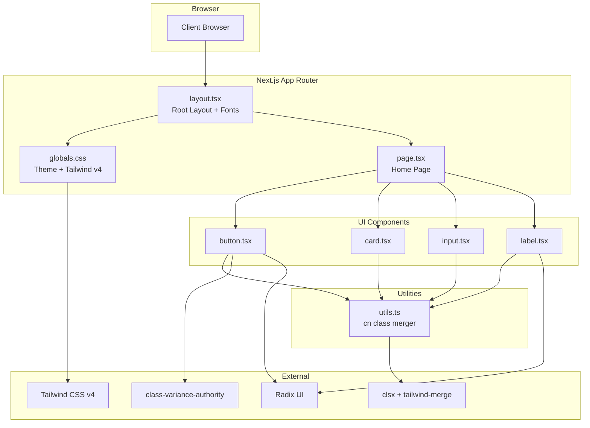
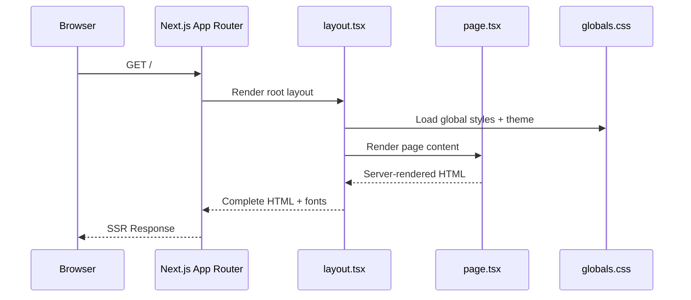

# Codebase Map

> Auto-generated by Cartographer. Last mapped: 2026-02-07T23:46:23Z

## System Overview



## Directory Structure

```
relay/
├── src/
│   ├── app/                    # Next.js App Router pages & layouts
│   │   ├── layout.tsx          # Root layout (Geist fonts, metadata)
│   │   ├── page.tsx            # Home page (/)
│   │   └── globals.css         # Global styles, Tailwind v4 theme, CSS vars
│   ├── components/
│   │   └── ui/                 # shadcn/ui components (new-york style)
│   │       ├── button.tsx      # Polymorphic button with CVA variants
│   │       ├── card.tsx        # Composable card with sub-components
│   │       ├── input.tsx       # Styled input extending native <input>
│   │       └── label.tsx       # Accessible label wrapping Radix primitive
│   └── lib/
│       └── utils.ts            # cn() utility (clsx + tailwind-merge)
├── public/                     # Static assets
├── components.json             # shadcn/ui CLI configuration
├── eslint.config.mjs           # ESLint v9 flat config
├── next.config.ts              # Next.js configuration
├── postcss.config.mjs          # PostCSS with @tailwindcss/postcss
├── tsconfig.json               # TypeScript strict config with @/ alias
└── package.json                # Dependencies & scripts
```

## Module Guide

### App (`src/app/`)

**Purpose**: Next.js App Router entry points and global styles
**Entry point**: `layout.tsx` (root layout wrapping all pages)

| File          | Purpose                                            | Tokens |
| ------------- | -------------------------------------------------- | ------ |
| `layout.tsx`  | Root layout with Geist fonts and metadata          | 176    |
| `page.tsx`    | Home page at `/` (Server Component)                | 660    |
| `globals.css` | Tailwind v4 config, CSS variables, dark mode theme | 1,705  |

**Key details**:

- `layout.tsx` loads Geist Sans + Geist Mono via `next/font/google`, exports metadata
- `page.tsx` is a Server Component using `next/image` for optimized images
- `globals.css` uses Tailwind v4 CSS-first config with OKLCH color space, `@theme inline` for variable mapping, and class-based dark mode via `@custom-variant dark`

### UI Components (`src/components/ui/`)

**Purpose**: shadcn/ui components following the "new-york" style variant
**All components import**: `cn` from `@/lib/utils`

| File         | Purpose                                                     | Tokens |
| ------------ | ----------------------------------------------------------- | ------ |
| `button.tsx` | Polymorphic button with 6 variants + 8 sizes via CVA        | 644    |
| `card.tsx`   | Composable card with 7 sub-components (Header, Title, etc.) | 504    |
| `input.tsx`  | Styled input extending native `<input>` props               | 222    |
| `label.tsx`  | Accessible label wrapping Radix UI Label primitive          | 139    |

**Patterns**:

- CVA (class-variance-authority) for variant management in Button
- Radix UI primitives for accessible headless behavior (Button Slot, Label)
- `data-slot` attributes on all components for CSS targeting
- Composition pattern in Card (sub-components: Card, CardHeader, CardTitle, CardDescription, CardAction, CardContent, CardFooter)
- Only `label.tsx` requires `"use client"` (Radix UI dependency)

**Button variants**: default, destructive, outline, secondary, ghost, link
**Button sizes**: default, xs, sm, lg, icon, icon-xs, icon-sm, icon-lg

### Utilities (`src/lib/`)

**Purpose**: Shared utility functions
**Entry point**: `utils.ts`

| File       | Purpose                                         | Tokens |
| ---------- | ----------------------------------------------- | ------ |
| `utils.ts` | `cn()` function combining clsx + tailwind-merge | 45     |

**How `cn()` works**: `clsx` combines conditional classes into a string, then `twMerge` resolves Tailwind conflicts (e.g., `px-2 px-4` becomes `px-4`).

### Configuration

| File                 | Purpose                                                       | Tokens |
| -------------------- | ------------------------------------------------------------- | ------ |
| `components.json`    | shadcn/ui config: new-york style, RSC, Lucide icons, CSS vars | 149    |
| `eslint.config.mjs`  | ESLint v9 flat config with Next.js Core Web Vitals + TS       | 115    |
| `next.config.ts`     | Next.js config (minimal/empty)                                | 30     |
| `postcss.config.mjs` | PostCSS with `@tailwindcss/postcss` plugin (Tailwind v4)      | 24     |
| `tsconfig.json`      | Strict TS, bundler resolution, `@/*` path alias to `src/*`    | 206    |
| `package.json`       | Project deps & scripts (dev, build, start, lint)              | 281    |

## Data Flow



## Tech Stack

| Technology   | Version | Purpose                                 |
| ------------ | ------- | --------------------------------------- |
| Next.js      | 16.1.6  | React framework (App Router, Turbopack) |
| React        | 19.2.3  | UI library                              |
| TypeScript   | 5.x     | Type safety (strict mode)               |
| Tailwind CSS | 4.x     | Utility-first CSS (CSS-first config)    |
| shadcn/ui    | 3.8.4   | Component library (new-york style)      |
| Radix UI     | 1.4.3   | Headless accessible primitives          |
| CVA          | 0.7.1   | Component variant management            |
| Lucide React | 0.563.0 | Icon library                            |
| ESLint       | 9.x     | Linting (flat config)                   |

## Conventions

- **Server Components by default** - only add `"use client"` when required (e.g., Radix primitives)
- **Path alias**: `@/` maps to `src/` (configured in tsconfig.json)
- **Class merging**: always use `cn()` for dynamic className composition
- **CSS variables for theming**: OKLCH color space in `:root` and `.dark`
- **Component data attributes**: `data-slot="name"` on all UI components
- **Tailwind v4 CSS config**: no `tailwind.config.js`, all theme in `globals.css`
- **Font optimization**: Geist fonts loaded via `next/font/google`

## Gotchas

- **Tailwind v4** uses `@import "tailwindcss"` not `@tailwind` directives; config lives in CSS via `@theme inline`
- **OKLCH colors** require modern browsers; all theme colors use this format
- **Button has no forwardRef** - may cause ref warnings in some contexts
- **Card border spacing** uses descendant selectors (`.border-b` class on parent)
- **Label is client-side only** due to Radix UI dependency
- **Package name** is `relay-temp2` in package.json (should be renamed to `relay`)
- **`@/` alias** only resolves to `src/`, not root-level files

## Navigation Guide

**To add a new page**: Create `src/app/<route>/page.tsx`
**To add a new layout**: Create `src/app/<route>/layout.tsx`
**To add a new shadcn component**: Run `npx shadcn@latest add <component>`
**To add a custom component**: Create in `src/components/` and import `cn` from `@/lib/utils`
**To modify the theme**: Edit CSS variables in `src/app/globals.css` (`:root` and `.dark` blocks)
**To add dark mode toggle**: Add a client component that toggles `.dark` class on `<html>`
**To add a new utility**: Add to `src/lib/` and export
